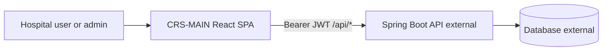
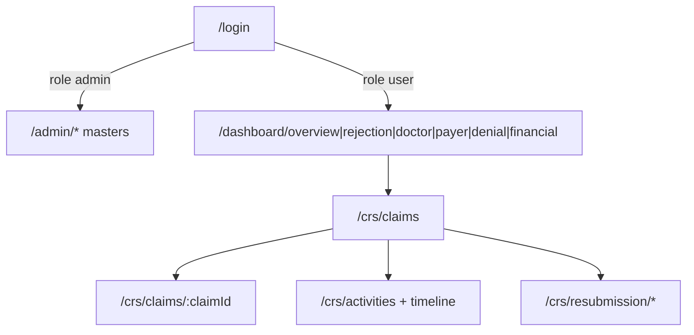

# ClaimSync (CRS-MAIN) — New Employee Brief

## One-liner

**ClaimSync** is a hospital **claims revenue / remittance / denial** product (UAE-flavored: Emirates ID, IP/OP, payers, clinicians). **This repo (`CRS-MAIN`) is only the React frontend.** Backend (Spring Boot `com.example.crs`), database, and Docker live in other ClaimSync repos / [ClaimSync_DevOps](https://github.com/curecloudtechnology/ClaimSync_DevOps).

README still says “Hospital Management System” with appointments/patients — **ignore that**. Real product = claims analytics + ClaimSync Reports (CRS) + admin master data.

---

## What the product does

Hospital staff use ClaimSync to:

1. **See money flow** — dashboards for overview, rejections, doctors, payers, denials, financial risk
2. **Work claims** — list/filter claims & activities, drill into claim detail, timeline
3. **Resubmit** — insurer-focused resubmission workflow
4. **Configure masters** (admins) — offices, users, clinicians, denial codes/reasons, CPT mapping, payers, senders, etc.



---

## Repo layout (what you’ll touch)

| Path | What it is |
|------|------------|
| [`src/App.jsx`](../src/App.jsx) | Routes |
| [`src/main.jsx`](../src/main.jsx) | Bootstrap (`AuthProvider`, etc.) |
| [`src/pages/auth/`](../src/pages/auth/) | Login |
| [`src/pages/admin/`](../src/pages/admin/) | Master-data CRUD |
| [`src/pages/user/`](../src/pages/user/) | Dashboard shell, CRS reports, activities, claim details |
| [`src/components/analytics-dashboard/`](../src/components/analytics-dashboard/) | Lazy-loaded chart tabs |
| [`src/context/`](../src/context/) | Auth, filters, sync, export cache |
| [`src/hooks/`](../src/hooks/) | Dashboard / CRS data hooks |
| [`src/utils/apiFetch.js`](../src/utils/apiFetch.js) | Authenticated `fetch` |
| [`src/config/dashboardApiMode.js`](../src/config/dashboardApiMode.js) | Flags: live API vs mock per dashboard slice |
| [`docs/`](./) | API ↔ UI mapping (read these) |
| [`_tmp_auth/`](../_tmp_auth/) | Decompiled backend `.class` scraps — **not** app source |

**Not a monorepo.** No DB, no Spring controllers, no Docker here.

---

## Roles and screens

**Auth:** JWT Bearer (not cookies). Login → `POST /api/auth/login` → store `token` + `user` in `localStorage` → all calls via `Authorization: Bearer …` ([`AuthContext.jsx`](../src/context/AuthContext.jsx), [`apiFetch.js`](../src/utils/apiFetch.js)).

| Role | Shell | Main areas |
|------|-------|------------|
| `admin` | [`AdminLayout`](../src/layouts/AdminLayout.jsx) | `/admin/*` — users, offices, clinicians, denial codes, CPT mapping, payers, senders… |
| `user` | [`UserLayout`](../src/layouts/UserLayout.jsx) | `/dashboard/*` analytics + `/crs/*` claims/activities/resubmission |

**Data scope:** user `permission` = `Office` (own office only) vs `All` (multi-office). Frontend applies this when building report queries; backend enforcement is outside this repo.

---

## User flows worth knowing



- **Analytics:** ECharts sections under `/dashboard/...`, often office/date filtered; some slices still gated by [`dashboardApiMode.js`](../src/config/dashboardApiMode.js).
- **CRS reports:** heavy list/filter/export against `/api/activity-report*` and related endpoints.
- **Admin:** CRUD against `/api/offices`, `/api/users`, `/api/clinicians`, etc.

Full endpoint ↔ file map: [`API_AND_FRONTEND_MAPPING.md`](./API_AND_FRONTEND_MAPPING.md), [`DASHBOARD_PAGES_API_MAPPING.md`](./DASHBOARD_PAGES_API_MAPPING.md).

---

## How the frontend talks to the backend

1. Put backend origin in `.env`: `VITE_API_BASE_URL=https://your-api-host`
2. App always calls **relative** `/api/...`
3. Vite proxies `/api` → that URL ([`vite.config.js`](../vite.config.js))
4. Production deploy is not configured in this repo — merge to `dev` triggers **ClaimSync_DevOps** (see [`.github/workflows/`](../.github/workflows/))

`src/services/apiClient.js` is a stub — real traffic is raw `fetch` + `apiFetch`.

---

## Domain vocabulary (so meetings make sense)

- **Claim** — invoice / submission to payer (facility, patient, clinician, amounts, denial codes)
- **Activity** — line / transaction under a claim (CPT, remittance trail)
- **Denial** — rejected portion + reason/code masters
- **Payer / Sender / Receiver** — insurance-side parties
- **Office** — hospital branch/facility; scopes data
- **Resubmission** — sending a claim back after denial
- **Sync** — backend data refresh status (`/api/sync/*`) shown in the user portal

---

## Local setup (day 1)

```bash
npm install
# .env: VITE_API_BASE_URL=<reachable Spring API>
npm run dev   # http://localhost:5173
```

Needs a live backend. Node 18+ locally; CI uses Node 22. Branches: work against `dev` (PRs); `master` ≈ prod per README.

---

## Where to dig next (by task)

| You’re asked to… | Start here |
|------------------|------------|
| Fix login / roles | [`src/context/AuthContext.jsx`](../src/context/AuthContext.jsx), layouts |
| Change a chart tab | [`src/components/analytics-dashboard/`](../src/components/analytics-dashboard/), [`src/hooks/`](../src/hooks/) |
| Claims list / filters / Excel | [`src/pages/user/crs-report/`](../src/pages/user/crs-report/), [`src/utils/claimsReportQuery.js`](../src/utils/claimsReportQuery.js) |
| Admin master screen | matching folder under [`src/pages/admin/`](../src/pages/admin/) |
| Which API field maps where | [`docs/`](./), [`Dashboard_API_Field_Audit.md`](../Dashboard_API_Field_Audit.md) |
| Deploy / infra | **ClaimSync_DevOps** repo, not here |

---

## Mental model for the new hire

> “I’m building UI for claim money visibility and denial/resubmission work. I call `/api/*` with a JWT. Data and auth rules come from a separate Spring service. If something is wrong with data shape or login validation, it’s often a backend contract issue — check `docs/` before guessing.”
